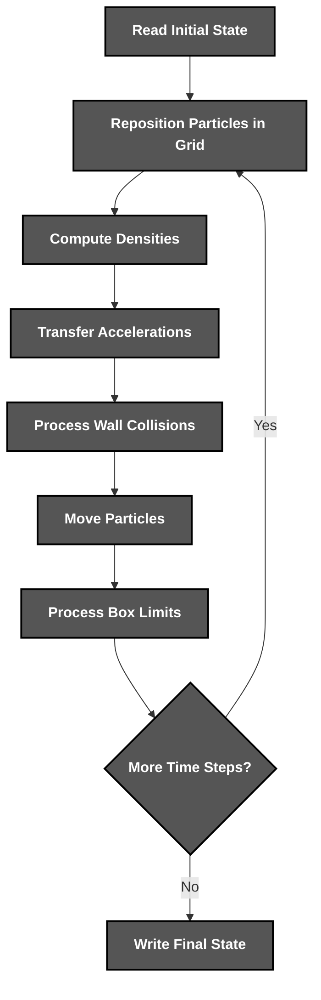
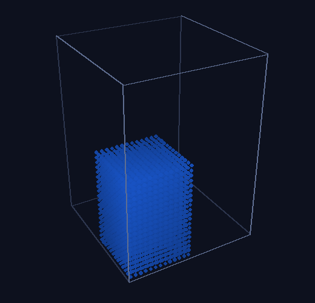

<div align="center">


*A fast **SPH** fluid solver for the **Navier–Stokes** equations*

</div>

# 📝 **Description**

<div align="center">

***Fluid*** is a **sequential SPH simulator** that models a liquid as thousands of particles and finds their neighbours through a ***grid of blocks*** to solve the ***Navier–Stokes equations*** fast
</div>
<br>
<div align="right">

***It was born as a fourth-year university project*** 🎓

</div>

# 🛠️ **Simulator Architecture & Workflow**

<div align="center">


</div>

# 📁 **Project Structure**

```
fluid/
├── .clang-format                                       # Code Style Configuration
├── .gitattributes                                      # Git Attributes Configuration
├── .gitignore                                          # Git Ignore Rules
├── CMakeLists.txt                                      # Build Configuration
├── LICENSE                                             # Project License
├── README.md                                           # You are here! ⬅️
│
├── .github/workflows/
│   └── ci.yml                                          # Format, Build & Test Pipeline
│
├── assets/                                             # Visual Assets
│   ├── demo-3d.gif                                     # 3D Dam Break Recording
│   └── logo.png                                        # Project Logo
│
├── data/
│   ├── small.fld                                       # 4,800 Particles Input
│   ├── large.fld                                       # 15,138 Particles Input
│   └── reference/                                      # Course Reference Outputs
│
├── scripts/
│   ├── make_dam_break.py                               # Dam Break Generator
│   └── render_demo.py                                  # Demo GIF Renderer
│
├── src/
│   ├── main.cpp                                        # Entry Point
│   └── fluid/
│       ├── arguments.cpp                               # Command-Line Parsing
│       ├── fld_file.cpp                                # Binary File Reading & Writing
│       ├── grid.cpp                                    # Grid of Blocks & Neighbor Lists
│       ├── simulation.cpp                              # SPH Kernels & Time Integration
│       └── constants.hpp                               # Physical Constants
│
└── tests/                                              # Unit & Reference Tests
```

# 🔧 **Installation**

## 📋 Requirements

- **C++20**
- **CMake 3.22+**

## ⚙️ Quick Setup

1. **Clone the repository**
   ```bash
   git clone https://github.com/cristiangilsanz/fluid.git
   cd fluid
   ```

2. **Configure the build**
   ```bash
   cmake -S . -B build -DCMAKE_BUILD_TYPE=Release
   ```

3. **Build the simulator**
   ```bash
   cmake --build build --config Release
   ```

<br>

# 🚀 **See *Fluid* in Action**

## 🌊 To Run a Simulation:

1. **Run the simulator:**

```bash
./build/src/fluid 1000 data/small.fld output.fld      # Windows: build\src\Release\fluid.exe
```

2. **It prints the simulation parameters and writes the final state to `output.fld`:**

```
Number of particles: 4800
Particles per meter: 204
Smoothing length: 0.00830882
Particle mass: 0.00011779
Grid size: 15 x 21 x 15
Number of blocks: 4725
Block size: 0.00866667 x 0.00857143 x 0.00866667
```

## 🎬 To Render the Demo:

1. **Install the rendering tools:**

```bash
pip install numpy pillow
```

2. **Render a 3D dam break to a GIF:**

```bash
python scripts/render_demo.py build/src/fluid assets/demo-3d.gif
```

## 🧪 To Run the Tests:

1. **Run the unit and reference tests:**

```bash
ctest --test-dir build --build-config Release
```

# 🎮 **Simulation**

<div align="center">
    
</div>

<br>

## ⌨️ Arguments

<div align="center">

| Argument | Action | Description |
|:---:|---|---|
| `<steps>` | Set Time Steps | Advances the simulation one millisecond per step |
| `<input>` | Read Input | Loads the initial particles from a `.fld` file |
| `<output>` | Write Output | Saves the final particles to a `.fld` file |
| `--course-reference` | Use Course Model | Reproduces the original course formulas *(optional, goes first)* |

</div>

# 🧮 **Physics Model**

Each particle carries a position $\vec{p}$, a velocity $\vec{v}$ and a half-step velocity $\vec{hv}$. With $n$ particles per metre, the particle mass and the smoothing length are $m = \rho_0 / n^3$ and $h = 1.695 / n$, and only pairs closer than $h$ interact.

**Density** uses the poly6 kernel:

```math
\rho_i = \left( h^6 + \sum_{j} \left( h^2 - \lVert \vec{p}_i - \vec{p}_j \rVert^2 \right)^3 \right) \frac{315}{64 \pi h^9} m
```

**Pressure and viscosity** use the spiky and viscosity kernels, and every pair is evaluated once, adding $\Delta\vec{a}_{ij}$ to $i$ and subtracting it from $j$:

```math
\Delta\vec{a}_{ij} = \frac{(\vec{p}_i - \vec{p}_j) \frac{15}{\pi h^6} \frac{3 m p_s}{2} \frac{(h - r_{ij})^2}{r_{ij}} (\rho_i + \rho_j - 2\rho_0) + (\vec{v}_j - \vec{v}_i) \frac{45}{\pi h^6} \mu m (h - r_{ij})}{\rho_i \rho_j}
```

**Walls** push particles back with a spring–damper force, then reflect any particle that still crosses a limit. **Time integration** is a leapfrog scheme with $\Delta t = 10^{-3}$ s:

```math
\vec{p} \leftarrow \vec{p} + \vec{hv} \Delta t + \vec{a} \Delta t^2, \qquad \vec{v} \leftarrow \vec{hv} + \frac{\vec{a} \Delta t}{2}, \qquad \vec{hv} \leftarrow \vec{hv} + \vec{a} \Delta t
```

All the maths runs in **double precision**, while the binary `.fld` files store **single precision** values.

# ⚡ **Performance & Energy**

The following table compares **1000 time steps** on `large.fld` with the course model, run on the university's ***Avignon*** cluster and on my PC:

<div align="center">

| Metric | Avignon *(original code)* | My PC *(current code)* |
|---|---|---|
| Execution time | 48.63 s ± 0.22% | 19.07 s ± 12.57% |
| CPU package energy | 504.64 J ± 0.18% | — |
| CPU cores energy | 246.85 J ± 0.18% | — |
| RAM energy | 126.34 J ± 0.43% | — |
| Instructions | 302.88 billion | 112.02 billion |
| Instructions per cycle | 1.87 | 1.94 |
| Branch mispredictions | 0.50% | 0.52% |

</div>

The solver is strictly **sequential**, so every gain comes from the algorithm and the memory layout:

- ***Contiguous storage***
- ***Double buffering***
- ***Grid of blocks***
- ***Integer powers***
- ***Ordered traversal***
- ***Pair caching***
- ***Precomputed constants***
- ***Symmetric pairs***

# 💡 **Tips for Best Results**

Each step simulates one millisecond, so a thousand steps give one second of fluid.

**Examples of a great run:**

> - Run ***data/small.fld*** for 1000 steps to see a pool settle.
> - Simulate a ***dam break*** made with `scripts/make_dam_break.py`.
> - Feed each output back as input to ***chain runs***.

Use a **Release** build, because the physics loops are much faster with optimisations.

# 📚 **Tech Stack & Other Resources**

## 📦 Tech Stack

### 🧩 **Programming Language**
- [C++20](https://en.cppreference.com/w/cpp/20)

### 🏗️ **Build System**
- [CMake](https://cmake.org/documentation/)

### 🧪 **Testing**
- [GoogleTest](https://google.github.io/googletest/)

### 🧹 **Code Quality**
- [clang-format](https://clang.llvm.org/docs/ClangFormat.html)

### 🎬 **Visualisation**
- [NumPy](https://numpy.org/doc/)
- [Pillow](https://pillow.readthedocs.io/)

### ⚙️ **Continuous Integration**
- [GitHub Actions](https://docs.github.com/actions)

# 🙏 **Credits & Thanks**

This simulator was created together with ***Eduardo Alconada Sola***, ***Alejandro Jiménez Valero*** and ***Rodrigo Toldos Frutos*** 🤝 in our fourth year of university.

Thanks to *José Daniel García Sánchez*, *David Expósito Singh* and *Rubén Chazo Paz* for guiding the project, and to *Matthias Müller*, *David Charypar* and *Markus Gross* for the original **particle-based fluid simulation** method ✨.

# 📄 **License**

This project is licensed under the MIT License - see the [LICENSE](LICENSE) file for details.

# 📞 **Get Help & Connect**

- 🐛 [Open an issue](https://github.com/cristiangilsanz/fluid/issues)
- 📧 cristiangilsanz@gmail.com

<div align="center">
  <br>

  **Made with 💖 for the Simulation Community**

  [⭐ Star this repo](https://github.com/cristiangilsanz/fluid) | [🍴 Fork it](https://github.com/cristiangilsanz/fluid/fork)

  <br>

  <a href="https://www.buymeacoffee.com/cristiangilsanz" target="_blank">
    
  </a>

</div>
